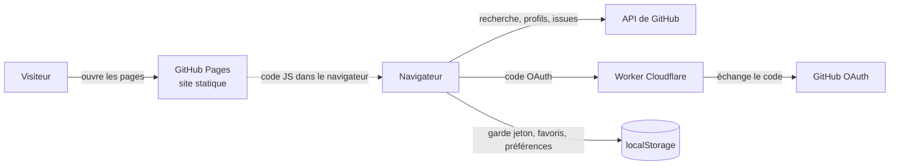
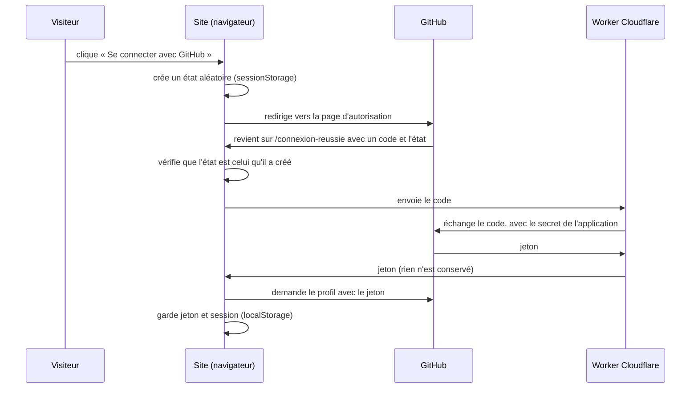

# Architecture de Repolink

Repolink est un site **statique** : il n'a ni serveur ni base de données. Tout ce qui est personnel (connexion, favoris, préférences) vit dans le navigateur, et les données viennent de l'API publique de GitHub.

## Vue d'ensemble

## Construction et déploiement

Le workflow `.github/workflows/deploiement.yml` tourne à chaque push sur `main`, chaque jour à 5 h UTC et à la demande :

1. `npm run verifier` : contrôle des types (`astro check`).
2. `npm test` : les tests du dossier `tests/`. Un test rouge bloque le déploiement.
3. `npm run donnees` : trois scripts (`scripts/`) interrogent l'API de GitHub avec le jeton du workflow et écrivent des JSON dans `src/data/` (accueil, Explorer, issues par langage). Si cette étape échoue, le site se construit quand même avec les données de secours.
4. `npm run build` : Astro génère le site dans `dist/`, avec le sitemap.
5. Publication sur GitHub Pages, sous `https://zaderlyl.github.io/repolink/` (la base `/repolink` est gérée par `lien()` dans `src/lib/adresses.ts`).

## D'où viennent les données

| Page | Données | Quand |
|---|---|---|
| Accueil (dont « Pépites à soutenir »), Explorer | JSON générés par `npm run donnees` | au build, rafraîchis chaque jour |
| Pages `/good-first-issues/<langage>/` | `src/data/langages.json` | au build, rafraîchis chaque jour |
| Recherche, Good first issues, fiches repo, profils | API de GitHub | dans le navigateur, à chaque visite |
| Blog | `src/data/blog.ts` | écrites à la main |

Dans le navigateur, `src/lib/github.ts` appelle l'API et `src/lib/cache.ts` garde chaque réponse une heure dans le `localStorage`, pour rester sous la limite de GitHub (60 requêtes par heure sans jeton, 5 000 avec).

## Les pépites de l'accueil

La section « Pépites à soutenir » met en avant des petits projets : 1 à 50 étoiles, créés ces 12 derniers mois, actifs ces 30 derniers jours, avec au moins une good first issue. `src/lib/pepites.ts` construit la requête et choisit quatre repos (les personnes avant les organisations, un seul par auteur). Le choix est refait à chaque déploiement. Sans données, la section n'est pas affichée : il n'y a pas de pépites d'exemple.

## La recherche

Les filtres vivent dans l'adresse de la page : `?q=…&langage=Go,Rust&topic=cli&taille=petits&langue=fr&page=2`. `src/lib/recherche.ts` les lit (`lireFiltres`), les transforme en requête GitHub (`construireRequete`) et reconstruit les adresses (`hrefRecherche`). Plusieurs langages se combinent en OU, plusieurs topics en ET, comme le fait GitHub quand on répète le même critère. Cette logique est testée dans `tests/recherche.test.ts`.

## La connexion avec GitHub

- Le site ne peut pas garder le secret de l'application : il n'existe que chez Cloudflare (`CLIENT_SECRET`). Voir `worker/README.md`.
- L'application ne demande aucune permission : le jeton ne permet que de lire des informations publiques.
- Le code côté site est dans `src/lib/oauth.ts`, `token.ts`, `session.ts` et `src/scripts/connexion*.ts`. Le Worker n'accepte que les requêtes du site et du serveur local.
- La connexion ne marche qu'en production : une seule adresse de retour est enregistrée dans l'OAuth App.

## Référencement

- `@astrojs/sitemap` génère `sitemap-index.xml` ; `public/robots.txt` bloque les pages privées.
- `layouts/layout.astro` ajoute titre, description, URL canonique et balises Open Graph à chaque page.
- Les articles ont des données structurées `BlogPosting` (`src/pages/blog/[slug].astro`).
- Les pages par langage donnent à Google du contenu lisible sans JavaScript.

## Organisation du code

Voir la section « Structure » du [README](../README.md). En résumé : `pages/` pour les routes, `components/` pour l'affichage, `scripts/` pour ce qui s'exécute dans le navigateur, `lib/` pour la logique testable, `data/` pour les listes et les JSON générés.
